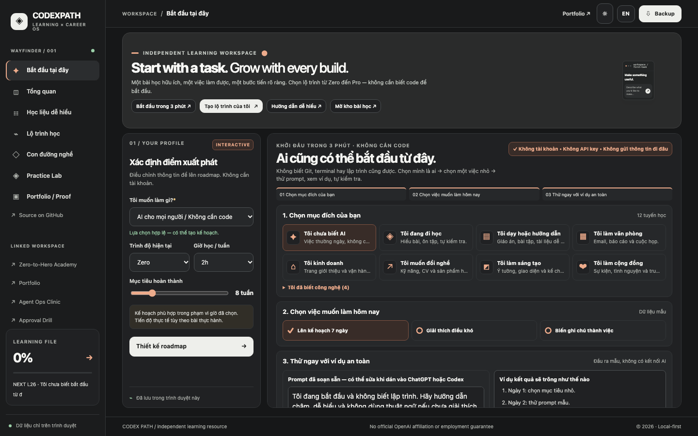

# Codex Path: Learning & Career OS

**Open the app: https://codex.xuanhieu.org/demos/codex-path/**

A free, bilingual (Vietnamese/English) learning path for using Codex and ChatGPT to build real things, from zero to pro. Independent project by [github.com/xuanhieu](https://github.com/xuanhieu); not affiliated with or endorsed by OpenAI.

## What it does

- **14 learning tracks**, from everyday users with no coding background to professional developers, teachers, small businesses and community organisers.
- **61 bilingual lessons**, each with a hands-on exercise checklist, a copy-ready practice prompt for Codex or ChatGPT, a quiz and a reflection note.
- **A study plan that fits your week:** pick your level, hours per week and target weeks, and the app orders lessons so prerequisites come first.
- **Private by design:** no login, no account, no tracking. Progress stays in your own browser, and you can export it as JSON or Markdown.

## Lộ trình học Codex song ngữ

Ứng dụng miễn phí giúp người nói tiếng Việt học cách dùng Codex và ChatGPT để làm ra sản phẩm thật: 14 lộ trình, 61 bài học song ngữ có bài tập, prompt mẫu và câu hỏi kiểm tra. Không cần tài khoản, tiến độ chỉ lưu trong trình duyệt của bạn.

**Học ngay tại: https://codex.xuanhieu.org/demos/codex-path/**

## Source code

This repository is an introduction only. The source code is kept private and is not licensed for reuse or redistribution. Please learn through the live app.

Want to see Codex-built code you can study and run? Try the open-source [Agent Ops Clinic](https://github.com/xuanhieu/agent-ops-clinic).

Feedback and suggestions are welcome through [GitHub issues](https://github.com/xuanhieu/codex-learning-path/issues).

© 2026 Phạm Xuân Hiếu. All rights reserved.
